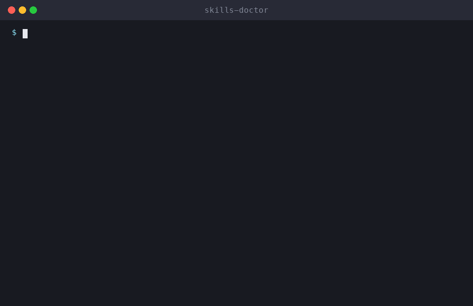

> [!NOTE]
> **This skill now lives in the main collection: [milad-ahmd/agent-skills](https://github.com/milad-ahmd/agent-skills/tree/main/skills/skills-doctor)**. Please ⭐ star it there; that's where updates land first.
> Docs: **https://milad-ahmd.github.io/agent-skills/skills/skills-doctor/** · Claude Code: `/plugin install all-skills --marketplace milad-ahmd/agent-skills`

<div align="center">

# 🩺 skills-doctor

**Audit your installed skills for broken frontmatter, vague triggers, conflicts and leaked secrets. An Agent Skill for Claude Code, Cline, Cursor, Codex and other AI coding agents.**

[](LICENSE)
[](https://github.com/milad-ahmd/skills-doctor)


[Use it in CI](#-use-it-in-ci) · [Install](#-install) · [Usage](#-usage) · [How it works](skills/skills-doctor/SKILL.md) · [All skills](https://github.com/milad-ahmd/agent-skills)



</div>

> Part of **[agent-skills](https://github.com/milad-ahmd/agent-skills)**, a growing collection of practical skills for AI coding agents.

## 🤖 Use it in CI

Lint the skills in any repo on every push and pull request. Problems show up as annotations on the exact file and line of the PR, and the job summary gets a table of everything found, plus the closest-overlapping pair of skills.

```yaml
# .github/workflows/skills.yml
name: Lint skills
on: [push, pull_request]

jobs:
  skills-doctor:
    runs-on: ubuntu-latest
    steps:
      - uses: actions/checkout@v4
      - uses: milad-ahmd/skills-doctor@v1
        # with:
        #   path: skills .claude/skills   # default: auto-detect
        #   fail-on: error                # default: warning (strict)
```

It's a composite action with no Docker and no dependencies. It uses the runner's own `python3` (3.9+), and only falls back to `actions/setup-python` when the runner has none.

| Input | Default | Meaning |
|---|---|---|
| `path` | auto-detect | Skills folders to lint, space- or newline-separated. Globs work (`plugins/*/skills`). Each entry can be a folder of skills or a single skill folder. By default, every one of `skills`, `.claude/skills` and `.agents/skills` that exists is linted. Paths with spaces aren't supported. |
| `strict` | `true` | `true`: warnings and overlaps fail the job, same as `skills_doctor.py --strict`. `false`: only errors fail it. |
| `fail-on` | *(from `strict`)* | Lowest severity that fails the job: `error`, `warning` or `never` (annotate only). When set, it overrides `strict`. |
| `overlap` | `0.20` | Jaccard threshold for two whole descriptions to count as overlapping. |
| `trigger-overlap` | `0.30` | Jaccard threshold for two "Use when…" clauses to count as overlapping. |

**Output:** `exit-code` gives the linter's raw result: `0` clean, `1` errors, `2` only warnings or overlaps. Use it with `fail-on: never` if you want to decide later in the job.

**Errors** are broken frontmatter, a name that isn't kebab-case, a missing description, a referenced script that doesn't exist, and possible secrets (AWS/GitHub/OpenAI/Slack/Stripe keys, private keys, `*_TOKEN=`-style assignments, credentials in URLs). **Warnings** are a name ≠ folder, a description that's too short or too long or has no "Use when…" trigger, and a SKILL.md over 500 lines. GitHub shows at most 10 error and 10 warning annotations per step, so the job summary lists every issue. No `permissions:` are needed.

## 📦 Install

**One command (installs the whole collection):**

```bash
curl -fsSL https://raw.githubusercontent.com/milad-ahmd/agent-skills/main/install.sh | bash -s -- skills-doctor
```

**Manually (Claude Code):**

```bash
git clone https://github.com/milad-ahmd/skills-doctor /tmp/skills-doctor
mkdir -p ~/.claude/skills && cp -r /tmp/skills-doctor/skills/skills-doctor ~/.claude/skills/
```

**Per project:** copy `skills/skills-doctor` into `<project>/.claude/skills/`.
**Any other agent:** paste [`SKILL.md`](skills/skills-doctor/SKILL.md) into your rules or system prompt.

## 💬 Usage

Just ask your agent:

```text
Check my installed skills
Why isn't my skill triggering?
```

The full workflow, rules and output format are in [`SKILL.md`](skills/skills-doctor/SKILL.md).

## 🧩 More skills

See the full collection: **[milad-ahmd/agent-skills](https://github.com/milad-ahmd/agent-skills)**.

## 🤝 Contributing

Issues and PRs are welcome, especially real-world before/after examples.

## 📄 License

[MIT](LICENSE) © Milad Ahmadi

<div align="center">

**If this skill saved you time, a ⭐ helps others find it.**

</div>
